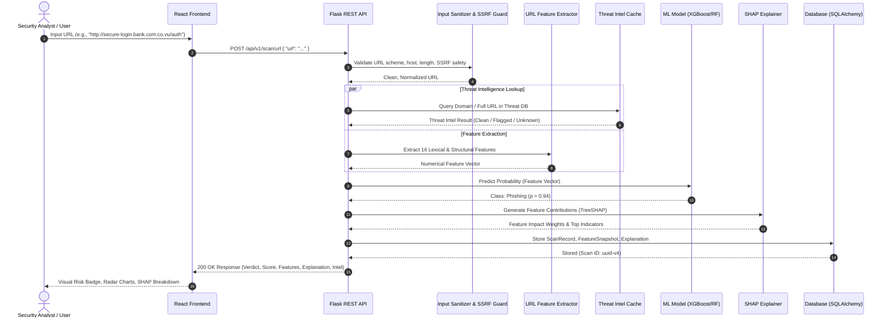
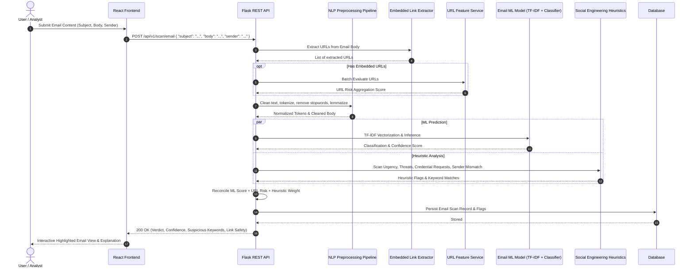
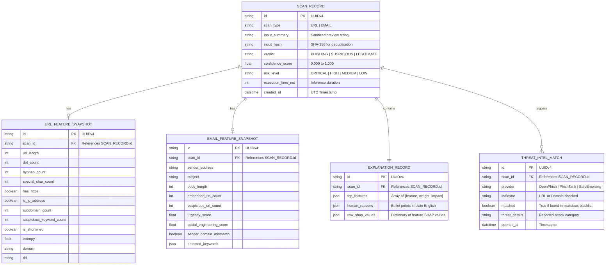

# AI-Based Phishing Attack Detection System
## System Architecture & Technical Specification (Phase 1)

**Document Version:** 1.0.0  
**Status:** Approved for Implementation  
**Target Audience:** Engineering Team, Code Reviewers, Technical Interviewers  

---

## 1. Requirement Analysis

### 1.1 Problem Statement & Domain Context
Phishing remains the predominant vector for cyber intrusions, credential harvesting, and enterprise ransomware deployments. Threat actors leverage obfuscated URLs, typosquatting, zero-day shortened redirects, and highly targeted social engineering emails. Traditional rule-based or blacklist-only security solutions suffer from high latency in identifying zero-hour attacks. 

This project engineers a dual-engine AI-based detection system:
1. **URL Structural & Lexical Engine:** Evaluates statistical, lexical, and architectural features of URLs with ensemble ML models to detect malicious domains prior to DNS resolution or page rendering.
2. **Email NLP Engine:** Applies linguistic preprocessing, TF-IDF vectorization, urgency/sentiment heuristics, and text classification models to evaluate email subjects, bodies, and embedded links.
3. **Explainable AI (XAI) Layer:** Provides interpretable explanations (via SHAP feature attribution and heuristic indicators) so security analysts understand *why* a classification was made.
4. **Threat Intelligence Aggregator:** Validates inputs against threat intelligence feeds (PhishTank, OpenPhish, Google Safe Browsing) to reconcile real-time zero-day ML predictions with known malicious databases.

### 1.2 Functional Requirements
- **FR-01: Dual-Input URL Analysis:** Accept single or batch URLs via REST API and web UI; normalize and sanitize input without invoking outbound HTTP requests (SSRF prevention).
- **FR-02: URL Feature Extraction:** Compute 15+ lexical, structural, and behavioral features (length, token counts, entropy, IP usage, shortening patterns, subdomain depth, protocol characteristics).
- **FR-03: Multi-Algorithm URL Classification:** Score extracted features through trained models (Logistic Regression, Decision Tree, Random Forest, XGBoost) and output classification (`Phishing`, `Suspicious`, `Legitimate`) alongside normalized confidence scores $[0.0, 1.0]$.
- **FR-04: Email Content Ingestion:** Ingest raw email text or standard MIME/RFC 822 format (subject, body, sender headers, links).
- **FR-05: Email NLP Classification:** Preprocess text (tokenization, stop-word removal, lemmatization, TF-IDF vectorization) and classify using best-performing text models.
- **FR-06: Explainability Pipeline:** Generate feature attribution weights via SHAP (TreeSHAP for tree models, LinearExplainer for linear models) and map them to human-readable risk factors.
- **FR-07: Threat Intelligence Cross-Referencing:** Query cached local feeds and remote threat intel APIs to cross-reference known bad domains/hashes without exposing backend infrastructure.
- **FR-08: Security Analytics Dashboard:** Provide real-time metrics, risk distribution breakdowns, recent scan logs, and model evaluation comparative matrices.
- **FR-09: Scan Audit History:** Persist all scan records, extracted feature snapshots, and explainability payloads with search, filter, and pagination capabilities.

### 1.3 Non-Functional Requirements
- **NFR-01: Low Latency Inference:** End-to-end inference for URL analysis must complete within $\le 50$ ms; Email NLP analysis within $\le 120$ ms.
- **NFR-02: Zero Network Fetch for Feature Extraction:** Extract structural features purely via static string parsing and offline heuristics. No dynamic outbound HTTP GET/POST to untrusted candidate URLs.
- **NFR-03: SSRF & Input Hardening:** Strict scheme validation (`http://`, `https://` only), disallow dangerous protocols (`file://`, `gopher://`, `dict://`, `javascript:`), and reject loopback/private IP ranges (`127.0.0.1`, `10.0.0.0/8`, `192.168.0.0/16`, `169.254.169.254`).
- **NFR-04: Modular & Testable Architecture:** Loose coupling between ML engines, Flask API routes, and persistence layer via Repository and Service patterns.
- **NFR-05: Privacy & Compliance:** Strip potential PII (e.g., passwords or sensitive tokens found in URL parameters or email bodies) before storing scan records.

---

## 2. System Architecture

```
+-------------------------------------------------------------------------+
|                              CLIENT TIER                                |
|   React 18 SPA (Vite, Tailwind CSS, Lucide Icons, Chart.js / Recharts)   |
|   - URL Scanner View     - Email Scanner View     - Security Dashboard  |
|   - Scan History View    - Model Metrics View     - Settings / API Keys |
+-------------------------------------------------------------------------+
                                    │
                           HTTPS / REST (JSON)
                                    │
+-------------------------------------------------------------------------+
|                           API GATEWAY TIER                              |
|                    Flask REST API (Application Factory)                 |
|   - CORS Middleware           - Rate Limiting        - Error Handler    |
|   - Input Sanitization & Marshmallow Request Validation Middleware      |
+-------------------------------------------------------------------------+
                                    │
+-------------------------------------------------------------------------+
|                           SERVICE LAYER                                 |
|  ┌──────────────────────────┐             ┌──────────────────────────┐  |
|  │    URL Scan Service      │             │    Email Scan Service    │  |
|  └─────────────┬────────────┘             └────────────┬─────────────┘  |
|                │                                       │                |
|  ┌─────────────▼────────────┐             ┌────────────▼─────────────┐  |
|  │ Feature Extraction Engine│             │ NLP Preprocessing Engine │  |
|  │ (Structural, Lexical,    │             │ (Tokenization, Cleanse,  │  |
|  │  Entropy, Heuristics)    │             │  TF-IDF Vectorizer)      │  |
|  └─────────────┬────────────┘             └────────────┬─────────────┘  |
+────────────────┼───────────────────────────────────────┼────────────────+
                 │                                       │
+────────────────▼───────────────────────────────────────▼────────────────+
|                          INFERENCE & XAI LAYER                          |
|  ┌───────────────────────────────────────────────────────────────────┐  |
|  │ ML Model Registry (Joblib Serialized Pipelines):                  │  |
|  │  - URL: XGBoost (Champion), Random Forest, Logistic Regression    │  |
|  │  - Email: TF-IDF + Logistic Regression / Naive Bayes / RF         │  |
|  └─────────────────────────────────┬─────────────────────────────────┘  |
|                                    │                                    |
|  ┌─────────────────────────────────▼─────────────────────────────────┐  |
|  │ Explainable AI (SHAP & Heuristic Rules Engine):                   │  |
|  │  - TreeSHAP feature attributions & top-k impact factors           │  |
|  │  - Social engineering & urgency linguistic indicator highlights  │  |
|  └─────────────────────────────────┬─────────────────────────────────┘  |
+────────────────────────────────────┼────────────────────────────────────+
                                     │
+------------------------------------+------------------------------------+
|                    DATA & THREAT INTEL TIER                             |
|  ┌─────────────────────────┐             ┌───────────────────────────┐  |
|  │ Threat Intel Aggregator │             │ Persistence Layer         │  |
|  │ - OpenPhish Feed Cache  │             │ - SQLAlchemy ORM          │  |
|  │ - PhishTank DB Check    │             │ - SQLite (Dev) /          │  |
|  │ - Google Safe Browsing  │             │   PostgreSQL (Prod)       │  |
|  └─────────────────────────┘             └───────────────────────────┘  |
+-------------------------------------------------------------------------+
```

---

## 3. Data Flow Diagrams

### 3.1 URL Scanning Pipeline Data Flow


### 3.2 Email Scanning Pipeline Data Flow


---

## 4. Technology Selection & Technical Justification

| Layer / Capability | Selected Technology | Alternative Considered | Technical Justification |
| :--- | :--- | :--- | :--- |
| **Frontend Framework** | **React.js 18+ (Vite)** | Next.js, Vue.js | High ecosystem maturity, component reusability, lightning-fast HMR via Vite, seamless state management for real-time dashboards. |
| **Styling & UI Kit** | **Tailwind CSS + Lucide Icons** | Bootstrap, Material UI | Utility-first styling enables clean, custom dark-cyberpunk and light-enterprise themes without bulky stylesheet overhead. |
| **Data Visualizations**| **Chart.js / Recharts** | D3.js | Declarative, lightweight, native responsive canvas/SVG charts for risk gauges, feature importances, and time-series trends. |
| **Backend Framework** | **Python Flask** | FastAPI, Django | Lightweight, unopinionated microframework perfectly suited for wrapping Python ML/NLP pipelines; full compatibility with scikit-learn, joblib, and SHAP. |
| **Data Validation** | **Marshmallow** | Pydantic | Robust serialization and deserialization seamlessly integrated with Flask request lifecycles and SQLAlchemy. |
| **Machine Learning** | **Scikit-learn + XGBoost** | PyTorch / TensorFlow | Tabular URL features benefit significantly from gradient-boosted decision trees (XGBoost) and Random Forests. Superior precision/recall with lower inference latency and zero GPU dependency. |
| **NLP Pipeline** | **NLTK + Scikit-Learn TF-IDF** | SpaCy, HuggingFace Transformers | Extremely fast CPU inference ($<50$ ms), lightweight deployment footprint, highly effective for spam/phishing vocabulary detection without 500MB+ transformer weights. |
| **Explainable AI (XAI)**| **SHAP (TreeSHAP)** | LIME | Mathematically principled Game-Theoretic Shapley values. TreeSHAP provides exact polynomial-time explanation for tree ensembles without sampling variance. |
| **Database & ORM** | **SQLAlchemy with SQLite (Dev) / PostgreSQL (Prod)** | MongoDB | Structured tabular relationships between scans, feature vectors, and explanations. SQLAlchemy allows instant switching between zero-config SQLite and PostgreSQL. |
| **Threat Intelligence**| **OpenPhish Feed & Google Safe Browsing API** | VirusTotal | OpenPhish provides accessible real-time phishing feed; Google Safe Browsing offers industry-standard authoritative validation. |

---

## 5. Database Schema

### 5.1 Entity-Relationship Diagram (ERD)


---

## 6. API Design Specification

### 6.1 Base URL & Versioning
- Base Path: `/api/v1`
- Format: JSON (`Content-Type: application/json`)
- Authentication: Optional API Key header (`X-API-Key`) for rate-limited endpoints.

### 6.2 Endpoints Summary

#### 1. URL Analysis
- **`POST /api/v1/scan/url`**
  - **Request Body:**
    ```json
    {
      "url": "https://paypal-security-update.com.security-check.xyz/login"
    }
    ```
  - **Response (`200 OK`):**
    ```json
    {
      "scan_id": "f47ac10b-58cc-4372-a567-0e02b2c3d479",
      "timestamp": "2026-11-15T09:30:00Z",
      "target": "https://paypal-security-update.com.security-check.xyz/login",
      "verdict": "PHISHING",
      "confidence": 0.942,
      "risk_level": "CRITICAL",
      "features": {
        "url_length": 58,
        "dot_count": 4,
        "hyphen_count": 2,
        "is_ip_address": false,
        "subdomain_count": 3,
        "has_https": true,
        "is_shortened": false,
        "entropy": 4.12
      },
      "explanation": {
        "summary": "High risk detected due to excessive subdomains, brand impersonation in subdomain, and abnormal domain entropy.",
        "top_contributing_features": [
          {"feature": "subdomain_count", "impact": "High Phishing Indicator", "value": 3},
          {"feature": "brand_in_subdomain", "impact": "Brand Impersonation ('paypal')", "value": true},
          {"feature": "suspicious_tld", "impact": "High-Risk TLD ('.xyz')", "value": "xyz"}
        ]
      },
      "threat_intel": {
        "provider": "OpenPhish",
        "matched": false,
        "status": "Zero-Day Malicious Pattern Identified by ML"
      },
      "execution_time_ms": 38
    }
    ```

#### 2. Email Analysis
- **`POST /api/v1/scan/email`**
  - **Request Body:**
    ```json
    {
      "sender": "security-alert@micros0ft-support.com",
      "subject": "URGENT: Your account has been suspended! Verify immediately",
      "body": "Dear customer, your Microsoft 365 access has been locked due to suspicious activity. Click here to confirm your password: http://192.168.1.100/verify or your account will be permanently deleted within 2 hours."
    }
    ```
  - **Response (`200 OK`):**
    ```json
    {
      "scan_id": "8a3d4f19-912b-4d43-85e1-7d9f6e5a1b2c",
      "timestamp": "2026-11-15T09:31:00Z",
      "verdict": "PHISHING",
      "confidence": 0.978,
      "risk_level": "CRITICAL",
      "email_indicators": {
        "urgency_score": 0.92,
        "social_engineering_patterns": ["Account Suspension Threat", "Artificial Deadline ('2 hours')"],
        "suspicious_keywords": ["suspended", "verify immediately", "permanently deleted", "confirm your password"],
        "sender_anomalies": ["Typosquatted domain 'micros0ft-support.com'"],
        "embedded_links": [
          {
            "url": "http://192.168.1.100/verify",
            "verdict": "PHISHING",
            "reason": "Direct IP address usage without HTTPS"
          }
        ]
      },
      "explanation": {
        "summary": "Extreme urgency cues combined with unencrypted IP destination and credential harvesting phrases indicate a high-confidence credential phishing attack."
      },
      "execution_time_ms": 84
    }
    ```

#### 3. Security Dashboard
- **`GET /api/v1/dashboard/stats`**
  - **Response (`200 OK`):**
    ```json
    {
      "total_scans": 1420,
      "url_scans_count": 980,
      "email_scans_count": 440,
      "phishing_detected": 412,
      "suspicious_detected": 188,
      "legitimate_detected": 820,
      "risk_breakdown": {
        "critical": 290,
        "high": 122,
        "medium": 188,
        "low": 820
      },
      "recent_scans": [ ... ]
    }
    ```

#### 4. Scan History & Pagination
- **`GET /api/v1/history?page=1&limit=20&type=url&verdict=PHISHING`**
- **`GET /api/v1/history/<scan_id>`**

#### 5. Model Metrics
- **`GET /api/v1/models/metrics`**
  - Returns actual cross-validation and test-set metrics (Accuracy, Precision, Recall, F1, ROC-AUC, Confusion Matrix) for all trained algorithms.

#### 6. System Health Check
- **`GET /api/v1/health`**
  - **Response (`200 OK`):**
    ```json
    {
      "status": "healthy",
      "models_loaded": {
        "url_classifier": true,
        "email_classifier": true
      },
      "database_connected": true,
      "version": "1.0.0"
    }
    ```

---

## 7. Project Folder Structure

```
Phishing_Project/
├── .gitignore
├── README.md
├── docs/
│   ├── architecture_and_system_design.md
│   ├── api_documentation.md
│   ├── dataset_sources.md
│   └── interview_qa.md
│
├── ml/
│   ├── datasets/
│   │   ├── raw/
│   │   │   ├── urls/            # Raw downloaded phishing & benign datasets
│   │   │   └── emails/          # Raw email phishing corpora (Enron, Nazario, Kaggle)
│   │   └── processed/           # Cleaned, stratified train/val/test splits
│   ├── feature_extraction/
│   │   ├── __init__.py
│   │   ├── url_features.py      # Lexical, structural, entropy, DNS heuristics
│   │   └── email_features.py    # NLP tokenization, TF-IDF, urgency heuristics
│   ├── training/
│   │   ├── __init__.py
│   │   ├── train_url_models.py   # LogisticRegression, DecisionTree, RF, XGBoost
│   │   └── train_email_models.py # TF-IDF + Naive Bayes, LogisticReg, Random Forest
│   ├── evaluation/
│   │   ├── __init__.py
│   │   ├── evaluate_models.py   # Metrics, ROC-AUC, Confusion Matrices generator
│   │   └── explainers.py        # SHAP TreeExplainer & LinearExplainer pipelines
│   └── saved_models/            # Joblib serialized models, vectorizers, metadata
│       ├── url_model_champion.joblib
│       ├── email_model_champion.joblib
│       ├── email_tfidf_vectorizer.joblib
│       └── model_metrics.json
│
├── backend/
│   ├── app.py                   # Application entry point / factory
│   ├── config.py                # Environment configs (Dev, Test, Prod)
│   ├── requirements.txt         # Backend Python dependencies
│   ├── routes/
│   │   ├── __init__.py
│   │   ├── scan_routes.py       # /api/v1/scan/url, /api/v1/scan/email
│   │   ├── dashboard_routes.py  # /api/v1/dashboard/stats
│   │   ├── history_routes.py    # /api/v1/history, /api/v1/history/<id>
│   │   └── health_routes.py     # /api/v1/health, /api/v1/models/metrics
│   ├── services/
│   │   ├── __init__.py
│   │   ├── url_scan_service.py  # Core inference & feature extraction orchestrator
│   │   ├── email_scan_service.py# NLP pipeline & heuristic orchestrator
│   │   ├── threat_intel_service.py # OpenPhish, PhishTank, SafeBrowsing client
│   │   └── explainability_service.py # SHAP & rule-based explanation generators
│   ├── models/
│   │   ├── __init__.py
│   │   └── db_models.py         # SQLAlchemy models (ScanRecord, Features, etc.)
│   └── utils/
│       ├── __init__.py
│       ├── security.py          # SSRF prevention, URL validation, sanitization
│       └── logger.py            # Structured logging
│
├── frontend/
│   ├── package.json
│   ├── vite.config.js
│   ├── tailwind.config.js
│   ├── postcss.config.js
│   ├── index.html
│   └── src/
│       ├── App.jsx
│       ├── main.jsx
│       ├── index.css
│       ├── components/
│       │   ├── Navbar.jsx
│       │   ├── Sidebar.jsx
│       │   ├── RiskBadge.jsx
│       │   ├── FeatureRadar.jsx
│       │   ├── ShapWaterfall.jsx
│       │   ├── StatCard.jsx
│       │   └── EmailHighlighter.jsx
│       ├── pages/
│       │   ├── Dashboard.jsx
│       │   ├── UrlScanner.jsx
│       │   ├── EmailScanner.jsx
│       │   ├── ScanHistory.jsx
│       │   ├── ModelPerformance.jsx
│       │   └── Settings.jsx
│       ├── services/
│       │   └── api.js           # Axios / Fetch client with error handling
│       └── hooks/
│           └── useDarkMode.js
│
└── tests/
    ├── test_url_features.py
    ├── test_email_features.py
    ├── test_api_endpoints.py
    └── test_ssrf_security.py
```

---

## 8. Development Milestones & Roadmap

- **Phase 1: Architecture, Requirements & System Specification (Current)**
  - Deliverables: Comprehensive architectural blueprint, ERD, data flow diagrams, API schemas, tech stack justification.
  - *Definition of Done (DoD):* User reviews and approves foundational blueprint.
- **Phase 2: Dataset Collection, Curation & Preprocessing**
  - Deliverables: Real-world balanced datasets for URLs (PhishTank/ISCX/Kaggle) and Emails (Enron/Nazario/SpamAssassin); automated cleaning script with zero data leakage; reproducible train/test splits.
- **Phase 3: URL Feature Extraction & Multi-Model Machine Learning Training**
  - Deliverables: Feature extractor producing 16+ numerical attributes; training pipeline for Logistic Regression, Decision Tree, Random Forest, and XGBoost; model comparison report with Joblib serialized champion model.
- **Phase 4: Email NLP Feature Engineering & Text Classifier Training**
  - Deliverables: Preprocessing pipeline (lemmatization, stop words, regex link extraction, urgency cues); TF-IDF vectorization; model training (Naive Bayes, Logistic Regression, Random Forest); serialized pipeline.
- **Phase 5: Explainable AI (SHAP) & Threat Intelligence Integration**
  - Deliverables: TreeSHAP/LinearExplainer pipeline; human-readable linguistic heuristic rules engine; OpenPhish and PhishTank threat intel service with local TTL caching.
- **Phase 6: Flask REST API & Secure Backend Implementation**
  - Deliverables: Production-ready Flask application factory; SQLAlchemy models; endpoints (`/scan/url`, `/scan/email`, `/dashboard/stats`, `/history`, `/health`); comprehensive input sanitization and SSRF defenses.
- **Phase 7: React Frontend Development (Vite + Tailwind CSS)**
  - Deliverables: Modern cybersecurity UI with dark/light themes, sidebar navigation, URL scanner page, Email scanner page with live threat highlighting, scan history with filters.
- **Phase 8: Security Dashboard & Interactive Visualizations**
  - Deliverables: Real-time metrics overview, risk distribution doughnut charts, monthly attack trend lines, SHAP feature importance charts, model evaluation comparison matrix.
- **Phase 9: Comprehensive Testing & Verification**
  - Deliverables: Pytest suite covering feature extraction, ML inference, API endpoints, and SSRF security tests; frontend integration verification.
- **Phase 10: Final Documentation, Portfolio Assets & Interview Q&A**
  - Deliverables: Professional README.md with architecture diagrams, API docs, deployment guide (Docker/local), and curated software engineering & AI/ML cybersecurity interview Q&A guide.

